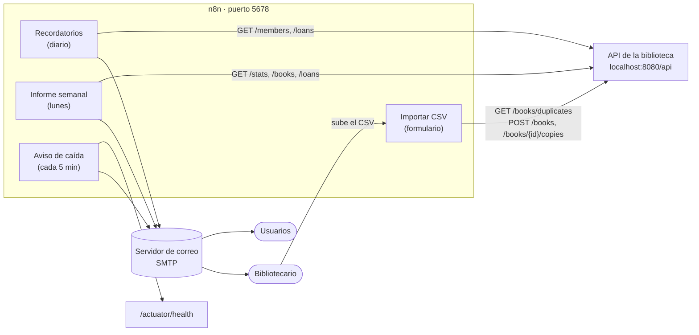
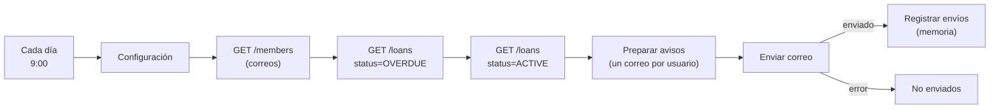

<div align="center">

# Automatizaciones n8n · Sistema de Biblioteca

**Recordatorios de préstamos, informe semanal, importación de libros desde CSV y aviso si el servidor se cae.**


</div>

Este proyecto es **independiente** del [Sistema de Biblioteca](https://github.com/zseuz/biblioteca): no modifica su código ni su base de datos. Solo usa su **API REST** (`http://localhost:8080/api`) desde [n8n](https://n8n.io), igual que lo haría la web.

---

## Índice

1. [Qué incluye](#qué-incluye)
2. [Requisitos](#requisitos)
3. [Puesta en marcha](#puesta-en-marcha)
4. [Configuración (`config.json`)](#configuración-configjson)
5. [Cómo funciona cada flujo](#cómo-funciona-cada-flujo)
6. [Importar libros desde CSV](#importar-libros-desde-csv)
7. [Correo con Gmail](#correo-con-gmail)
8. [Solución de problemas](#solución-de-problemas)
9. [Estructura del proyecto](#estructura-del-proyecto)

---

## Qué incluye

| Flujo | Cuándo | Qué hace |
|---|---|---|
| **Recordatorios de préstamos** | Cada día, 9:00 | Envía a cada usuario **un correo** con sus préstamos **vencidos** y los que **vencen en 3 días o menos**, indicando si ya puede renovarlos. No repite avisos. |
| **Informe semanal** | Lunes, 8:00 | Envía al bibliotecario un resumen en HTML: indicadores, vencidos (con enlace para escribir al usuario), los que vencen en 7 días, préstamos de la semana, libros agotados, los más prestados y la evolución por mes. |
| **Importar libros desde CSV** | Al enviar un formulario | Formulario web para subir un CSV. Si el libro ya existe, **suma los ejemplares**; si no, lo **crea**. Muestra el resultado fila por fila. |
| **Aviso si el servidor no responde** | Cada 5 minutos | Consulta `/actuator/health`. Si falla 2 veces seguidas, avisa por correo **una vez**; cuando vuelve, avisa de nuevo con el tiempo que estuvo caído. |



---

## Requisitos

| Necesitas | Para qué |
|---|---|
| **Node.js 22.22 o superior** | Ejecutar n8n. Se usa n8n **2.35.7** porque las versiones posteriores exigen Node 24; si actualizas Node, puedes subir la versión en `package.json`. |
| **El backend de la biblioteca en marcha** | Los flujos leen y escriben a través de su API. Clona [zseuz/biblioteca](https://github.com/zseuz/biblioteca) y, en su carpeta `backend`, ejecuta `.\mvnw.cmd spring-boot:run`. |
| **Una cuenta de correo con SMTP** | Enviar los correos. Con Gmail hace falta una *contraseña de aplicación* ([ver abajo](#correo-con-gmail)). |

---

## Puesta en marcha

**1. Instala n8n** (la primera vez; tarda varios minutos):

```bash
npm install
```

**2. Crea tu configuración** a partir del ejemplo y rellénala ([qué significa cada campo](#configuración-configjson)):

```bash
copy config.example.json config.json
```

**3. Carga la credencial de correo y los cuatro flujos en n8n** (con n8n detenido):

```bash
npm run preparar
```

**4. Arranca n8n:**

```bash
npm start
```

Abre **http://localhost:5678**. La primera vez te pedirá crear la cuenta de propietario: es una cuenta **local** de tu n8n, no de n8n.io.

**5. Prueba cada flujo:** ábrelo y pulsa **Execute workflow**. Mientras `correo.pruebas` tenga tu dirección, todos los recordatorios te llegarán a ti (el asunto indica a quién iban dirigidos), así que puedes probar sin molestar a nadie.

**6. Actívalos:** en cada flujo que quieras dejar funcionando, pulsa **Publish**. Los flujos programados solo se ejecutan **mientras n8n esté en marcha**.

> Cuando todo esté bien, deja `correo.pruebas` vacío (`""`) y vuelve a ejecutar `npm run preparar` para que los recordatorios lleguen a los usuarios. Ojo: `preparar` sustituye los flujos por los de la carpeta `workflows/`, así que pierdes los cambios que hayas hecho en el editor (y la memoria de avisos ya enviados).

---

## Configuración (`config.json`)

`config.json` no se sube a Git (contiene la contraseña del correo). `npm run preparar` copia estos valores en el nodo **Configuración** de cada flujo; también puedes cambiarlos después directamente en el editor.

| Campo | Ejemplo | Significado |
|---|---|---|
| `nombreBiblioteca` | `Biblioteca` | Aparece en el remitente, los asuntos y las firmas. |
| `zonaHoraria` | `America/Bogota` | Zona para las horas de ejecución y para calcular «hoy». |
| `api` | `http://localhost:8080` | Dirección del backend (sin `/api`). |
| `correo.remitente` | `tu-cuenta@gmail.com` | Dirección desde la que se envía. Con Gmail, la misma de `smtp.user`. |
| `correo.bibliotecario` | `tu-cuenta@gmail.com` | Recibe el informe semanal y los avisos de caída. Admite varias, separadas por comas. |
| `correo.pruebas` | `tu-cuenta@gmail.com` | **Modo de pruebas:** si tiene valor, los recordatorios van aquí y no a los usuarios. Vacío = envío real. |
| `recordatorios.diasAntesDeVencer` | `3` | Con cuántos días de antelación se avisa de que un préstamo vence. |
| `recordatorios.repetirVencidosCadaDias` | `7` | Cada cuántos días se repite el aviso de un préstamo vencido. |
| `avisoCaida.fallosParaAvisar` | `2` | Comprobaciones fallidas seguidas antes de avisar (evita falsas alarmas). |
| `smtp.*` | `smtp.gmail.com`, `465`, `true` | Servidor de correo: `host`, `port`, `secure` (TLS directo, puerto 465), `user` y `password`. |

---

## Cómo funciona cada flujo

Los tres flujos que envían correo usan la misma plantilla HTML, con los colores de la web: cabecera con degradado índigo (roja o verde en los avisos del servidor), tarjetas con etiquetas de estado y un texto de vista previa para la bandeja de entrada. Está hecha con tablas y estilos en línea para que se vea bien en Gmail, Outlook y en el móvil, y cada correo lleva también una versión en texto plano.

Todos los flujos empiezan por un nodo **Configuración** y llaman a la API con nodos **HTTP Request**. El historial de préstamos está paginado (`page`, `size`, `totalPages`), así que los nodos piden páginas de 100 hasta tenerlo todo, y paran antes cuando ya no necesitan más (por ejemplo, al llegar a préstamos que vencen dentro de más de 7 días).

### Recordatorios de préstamos



- La API de préstamos no incluye el correo del usuario, así que el flujo lo cruza con `GET /members` por `memberId`.
- **No repite avisos.** El flujo guarda en su memoria (*static data* de n8n) qué avisó y cuándo:
  - «vence pronto»: un aviso por préstamo y fecha límite (si se renueva, la fecha cambia y se volverá a avisar cuando toque).
  - «vencido»: un aviso y luego otro cada `repetirVencidosCadaDias` días mientras siga sin devolverse.
  - Esta memoria **solo se guarda con el flujo activado**. Al pulsar *Execute workflow* en el editor no se guarda, así que en las pruebas siempre salen todos los avisos.
- Si un correo falla, sale por la rama **No enviados** (con el motivo), no se apunta en la memoria y se reintenta en la siguiente ejecución. Los que sí se enviaron no se repiten.
- El texto usa las reglas del backend: los préstamos se renuevan cuando faltan 5 días o menos (`renewableFrom`), y quien tiene un préstamo vencido no puede llevarse otros libros.

Ejemplo de recordatorio (versión en texto plano):

```text
Asunto: «Cumbres borrascosas» vence en 3 días

Hola, Lector para Renovar:

Este préstamo vence pronto:
- «Cumbres borrascosas»: vence en 3 días, el 16/10/2026. Ya se puede renovar si lo necesitas más tiempo.

Un saludo,
Biblioteca
```

### Informe semanal

Consulta `GET /stats`, `GET /books`, `GET /members` y tres búsquedas de préstamos (vencidos, en plazo y recientes), compone un correo HTML con estilos en línea (los clientes de correo ignoran las hojas de estilo) y lo envía a `correo.bibliotecario`. Para recibirlo en el momento, pulsa *Execute workflow*.

### Aviso si el servidor no responde

Consulta `/actuator/health` cada 5 minutos (con 10 s de espera máxima). Considera que funciona si responde `200` con `"status": "UP"`. Recuerda entre comprobaciones cuántos fallos lleva, si ya avisó y desde cuándo está caído, así que **necesita estar activado** para funcionar. Al estar en el mismo equipo que el backend, sirve para detectar que se ha detenido el backend, no que se haya apagado el equipo.

---

## Importar libros desde CSV

Con el flujo activado, el formulario está en **http://localhost:5678/form/importar-libros**.

Formato: la primera fila es la cabecera y las columnas se reconocen sin importar mayúsculas ni tildes. Sirve tanto un CSV con `,` como uno con `;` (el que guarda Excel en español). Hay un ejemplo en [`ejemplos/libros.csv`](ejemplos/libros.csv).

| Columna | Alternativas admitidas | Obligatoria |
|---|---|---|
| `titulo` | `título`, `title`, `libro` | Sí |
| `autor` | `autora`, `author` | Sí |
| `genero` | `género`, `genre`, `categoria` | Sí |
| `ejemplares` | `copias`, `cantidad`, `unidades`, `copies` | No (1 si falta) |

Para cada fila se aplican las mismas reglas que en la web:

1. `GET /books/duplicates`: ¿existe ya un libro con el mismo título, autor y género?
2. Si existe → `POST /books/{id}/copies` suma los ejemplares.
3. Si no → `POST /books` lo crea. Si había uno con el mismo título y autor pero **otro género**, se crea igualmente y el resultado lo advierte («Ojo: ya existía con otro género»).
4. Si la API rechaza la fila (por ejemplo, un autor de menos de 3 caracteres), se muestra su mensaje y se sigue con las demás.

Las filas se procesan en orden, así que un libro repetido dentro del mismo CSV se crea una vez y luego se le suman los ejemplares.

> Cualquiera que pueda abrir `localhost:5678` puede usar el formulario. Si expones n8n fuera de tu equipo, protégelo: en el nodo **Formulario** → *Authentication* → *Basic Auth*.

---

## Correo con Gmail

1. Activa la verificación en dos pasos en tu cuenta de Google.
2. Crea una contraseña de aplicación en <https://myaccount.google.com/apppasswords>.
3. En `config.json`: `"host": "smtp.gmail.com"`, `"port": 465`, `"secure": true`, `"user"`: tu dirección de Gmail y `"password"`: la contraseña de aplicación (16 letras, sin espacios).
4. Usa esa misma dirección en `correo.remitente` (Gmail no permite enviar en nombre de otra).

Con Outlook u otros proveedores: `port` 587 y `secure` en `false` (STARTTLS).

---

## Solución de problemas

| Problema | Causa y solución |
|---|---|
| `npm install` dice que el motor no es compatible | Necesitas Node 22.22 o superior: `node -v`. |
| `npm run preparar` falla | Si n8n está en marcha, detenlo (Ctrl+C) y repite. Si dice que falta `config.json`, crea el archivo a partir de `config.example.json`. |
| Los nodos HTTP fallan con `ECONNREFUSED` | El backend no está en marcha o `api` no apunta a él. Comprueba <http://localhost:8080/api/books>. |
| *Invalid login* / *Username and Password not accepted* | Credenciales SMTP incorrectas. Con Gmail hace falta la contraseña de aplicación, no la de la cuenta. Puedes corregirla en n8n → *Credentials* → **SMTP Biblioteca**. |
| `/form/importar-libros` responde *Cannot GET* | El flujo de importación no está publicado, o n8n aún está arrancando. |
| Los flujos programados no se ejecutan | Deben estar **publicados** y n8n debe estar en marcha a esa hora. Revisa la pestaña *Executions*. |
| Se repiten recordatorios ya enviados | Volviste a ejecutar `npm run preparar`, que reinicia la memoria de los flujos, o los ejecutaste desde el editor, que no la guarda. |

---

## Estructura del proyecto

```text
biblioteca-n8n/
├── workflows/                       # Flujos de n8n listos para importar
│   ├── 1-recordatorios-prestamos.json
│   ├── 2-informe-semanal.json
│   ├── 3-importar-libros-csv.json
│   └── 4-aviso-servidor-caido.json
├── scripts/
│   └── preparar.mjs                 # Importa credencial y flujos con los valores de config.json
├── ejemplos/
│   └── libros.csv                   # CSV de ejemplo para el formulario
├── config.example.json              # Plantilla de configuración (copiar a config.json)
└── package.json                     # n8n 2.35.7 y los comandos preparar / start
```

Los datos de n8n (cuenta, credenciales cifradas, ejecuciones) se guardan en `%USERPROFILE%\.n8n`, no en esta carpeta.
